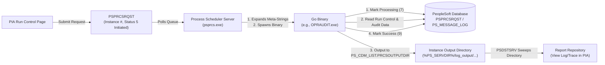

# go-psprcs

A lightweight, idiomatic Go library for building standalone, API-aware batch programs that run natively inside **PeopleSoft Process Scheduler**.

With `go-psprcs`, you can write modern Go applications that integrate seamlessly into PeopleSoft's batch lifecycle: scheduled via PIA run control pages, tracked in Process Monitor, logging structured messages to `PS_MESSAGE_LOG`, and delivering reports directly to the Report Repository (`PSDSTSRV`).

---

## Why Go for PeopleSoft Batch Processing?

PeopleSoft developers typically rely on Application Engine, SQR, COBOL, or shell scripts for batch processing. While Application Engine is tightly integrated with PeopleTools metadata, it can be cumbersome when generating modern formats (Markdown, JSON, Excel, REST payloads) or interacting with cloud APIs. SQR is a legacy language with declining tooling and proprietary runtimes.

Go offers a compelling modern alternative:

- **True Version Control & CI/CD**: PeopleSoft objects (Application Engine programs, PeopleCode events, and SQL definitions) lack native version control, residing as relational metadata in database tables. A Go batch program lives in standard Git with clean diffs, pull request code reviews, automated unit testing, and reproducible release tags.
- **Native Concurrency for Network-Bound Batch**: PeopleSoft batch engines are single-threaded. To achieve parallelism, developers traditionally resort to cumbersome temporary state record allocations (`MY_AET_1`, `MY_AET_2`) and multi-instance orchestration. For modern batch jobs calling external REST APIs (address cleansing, webhooks, payment processors, cloud sync), single-threaded execution wastes hours in network I/O wait. Go's lightweight goroutines make concurrent HTTP operations effortless, enabling worker pools of 50+ concurrent requests within a single process.
- **Single Static Binary**: Compiles to a self-contained executable with zero host dependencies. No Python virtualenvs, Node runtimes, or JVM warmup times on your batch servers.
- **Pure Go Oracle Driver**: Uses [`go-ora`](https://github.com/sijms/go-ora) to connect directly to Oracle databases without requiring Oracle Client libraries, OCI DLLs, or CGO. Cross-compilation from macOS or Linux to Windows (`GOOS=windows GOARCH=amd64`) works out of the box.
- **Instant Startup & High Performance**: Starts in milliseconds, executes with native compiled performance, and consumes minimal RAM.
- **Process Monitor Integration**: Full API-awareness allows your Go program to update `PSPRCSRQST` run statuses and emit message catalog entries to `PS_MESSAGE_LOG`.
- **Automatic Report Distribution**: Delivers output (Markdown, HTML, CSV, PDF) directly into the Process Scheduler Report Repository via `PSDSTSRV` ("View Log/Trace").

---

## How It Works



---

## Quick Start

### Installation

```bash
go get github.com/cedarhillsgroup/go-psprcs
```

### Writing a Process

```go
package main

import (
	"context"
	"database/sql"
	"fmt"
	"os"

	"github.com/cedarhillsgroup/go-psprcs"
	go_ora "github.com/sijms/go-ora/v2"
)

// ProcessName must not exceed 8 characters for generic Process Types
const ProcessName = "MYREPORT"

func main() {
	ctx := context.Background()

	// 1. Parse command-line flags provided by Process Scheduler
	params, err := psprcs.ParseFromArgs()
	if err != nil {
		fmt.Fprintf(os.Stderr, "Error parsing parameters: %v\n", err)
		os.Exit(1)
	}

	// 2. Connect to the PeopleSoft database using passed credentials
	connStr := go_ora.BuildUrl("localhost", 1521, params.DBName, params.AccessID, params.AccessPswd, nil)
	db, err := sql.Open("oracle", connStr)
	if err != nil {
		fmt.Fprintf(os.Stderr, "DB connection failed: %v\n", err)
		os.Exit(1)
	}
	defer db.Close()

	// 3. Initialize API-aware client and notify Process Scheduler
	client := psprcs.NewClient(db, params, ProcessName)
	if err := client.Start(ctx); err != nil {
		fmt.Fprintf(os.Stderr, "Failed to signal start: %v\n", err)
		os.Exit(1)
	}

	// Write a message to Process Monitor Message Log
	_ = client.LogMessage(ctx, psprcs.MsgSetProcessScheduler, 35, psprcs.SeverityInfo, "Processing batch work")

	// 4. Resolve output destination in Report Repository
	outputPath := client.OutputPath(ctx, "report.md")
	content := fmt.Sprintf("# Report for Run Control %s\n\nCompleted successfully.", params.RunControl)
	if err := os.WriteFile(outputPath, []byte(content), 0644); err != nil {
		_ = client.Fail(ctx, 2, err)
		os.Exit(2)
	}

	// 5. Signal success to Process Scheduler
	_ = client.LogMessage(ctx, psprcs.MsgSetProcessScheduler, 35, psprcs.SeverityInfo, "Report generated")
	if err := client.Success(ctx); err != nil {
		os.Exit(1)
	}
}
```

---

## PeopleSoft Configuration Details

### 1. The Generic Process Type (`GENPRCSTYPE = 0`)

When registering a custom executable in PeopleSoft (**PeopleTools > Process Scheduler > Process Types**), the underlying record is `PS_PRCSTYPEDEFN`.

The field `GENPRCSTYPE` categorizes the engine:

| Value |                      Meaning                      |
| ----- | ------------------------------------------------- |
| `0`   | **Other** (Custom Executables, Go, Rust, Scripts) |
| `1`   | SQR                                               |
| `2`   | PeopleSoft COBOL                                  |
| `3`   | Crystal Report                                    |
| `5`   | Application Engine                                |

For standalone compiled binaries, `GENPRCSTYPE` must be configured as **`0` (Other)**.

### 2. The 8-Character Process Name Limit

A critical PeopleTools behavior to be aware of: PeopleCode on `PRCSDEFN.PRCSNAME.SearchSave` validates the process definition name against `GENPRCSTYPE`:

```peoplecode
If GENPRCSTYPE <> "5" Then
   If Len(PRCSNAME) > 8 Then
      Error MsgGet(65, 47, "Process name for type %1 cannot exceed 8 characters in length.", %This.Value);
   End-If;
End-If;
```

Only Application Engine processes (`GENPRCSTYPE = 5`) permit 12-character names. All custom executables using `Other` (`GENPRCSTYPE = 0`) are hard-limited to a maximum of **8 characters** (e.g., `OPRAUDIT`, `MYREPORT`).

`go-psprcs` includes a built-in helper to guard against this:

```go
if err := psprcs.ValidateProcessName(ProcessName); err != nil {
    log.Fatal(err)
}
```

### 3. Process Type Definition Parameters

Configure the Process Type parameter list in PIA:

```text
-CT %%DBTYPE%% -CD %%DBNAME%% -CA %%ACCESSID%% -CAP %%ACCESSPSWD%% -I %%INSTANCE%% -R %%RUNCNTLID%% -CO "%%OPRID%%" -OT %%OUTDESTTYPE%% -FP "%%OUTDEST%%" -OF %%OUTDESTFORMAT%%
```

Notes:

- Meta-strings require double percent signs (`%%`).
- Enclose `%%ACCESSID%%` and `%%ACCESSPSWD%%` to pass database access credentials so pure-Go binaries can connect without local TNS configuration.

### 4. Delivering Reports to "View Log/Trace" (`PS_CDM_LIST`)

When a user submits a process with Output Type = **Web**, Process Scheduler sets `%%OUTDEST%%` to a distribution recipient string (such as `User:PS`), **not** a filesystem folder.

Process Scheduler creates a dedicated instance directory on the batch server (e.g., `%PS_SERVDIR%\log_output\OTH_<PRCSNAME>_<INSTANCE>\`). The path is recorded in `PS_CDM_LIST.PRCSOUTPUTDIR`.

`client.OutputPath(ctx, "report.md")` automatically queries `PS_CDM_LIST.PRCSOUTPUTDIR` so files are written directly into that folder.

### 5. Enabling Markdown (`.md`) in Report Distribution

By default, the Distribution Status Agent (`PSDSTSRV`) only transfers files matching the primary request format or files flagged as system diagnostics.

To allow `.md` files to transfer and display under **View Log/Trace**:

1. Navigate in PIA to: **PeopleTools > Process Scheduler > System Settings**
2. Select the **Distribution File Options** tab (`PRCSCDMFILE`)
3. Locate **MD** (Markdown) in the grid
4. Check the **System File** checkbox
5. Save the page

---

## Included Example: `OPRAUDIT`

The repository includes a complete reference implementation under `cmd/OPRAUDIT/`:

- Connects to Oracle via `go-ora`.
- Audits `PSOPRDEFN` across operator lock status, password expirations, failed logins, and symbolic IDs.
- Emits a clean Markdown security audit report directly to Report Manager.
- Logs step milestones to Process Monitor.

To cross-compile for Windows:

```bash
task build:windows
# Generated: bin/OPRAUDIT.exe
```

---

## License

MIT License. See [LICENSE](LICENSE) for details.
